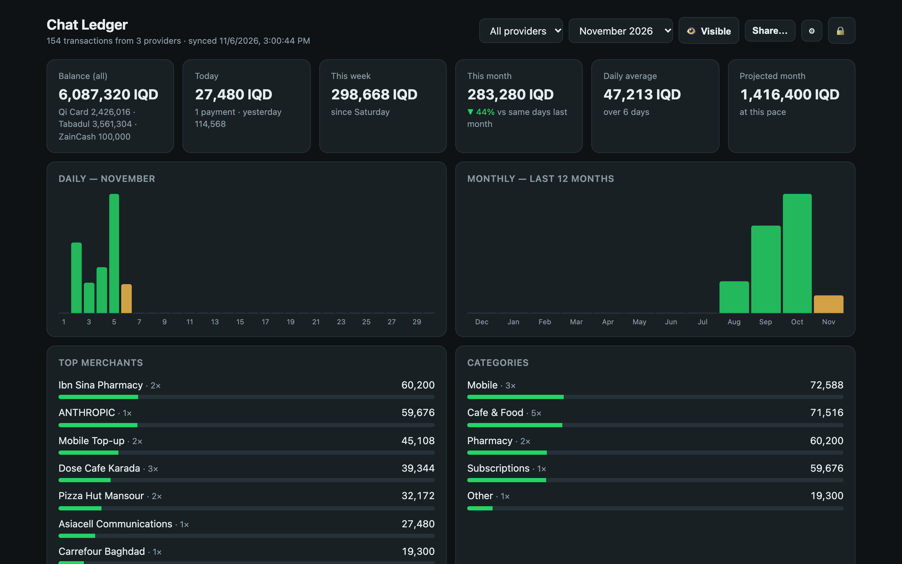
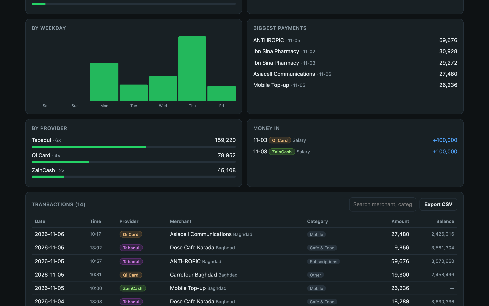

# Chat Ledger

**One private spending dashboard built from the transaction alerts your banks and wallets send to WhatsApp.**

Lots of banks, cards and e-wallets send every payment to WhatsApp. Chat Ledger is a Chrome extension: you give it
the names of those chats, and it reads them in WhatsApp Web and combines everything into one dashboard. Each
transaction is tagged with the provider it came from.

No account, no server, no AI, no network: the extension can't connect to anything except WhatsApp Web, and
nothing leaves your computer.

> [!IMPORTANT]
> **You tell it which chats to read.** Chat Ledger doesn't guess: it only opens the chats you add.
> Type each provider's chat name **exactly as it appears in WhatsApp** (for example `Tabadul`, `Qi Card`,
> `ZainCash`, or your bank's name), plus an optional tag for the dashboard.

> [!TIP]
> **Add as many providers as you like, whenever you like.** There's a place for it on the welcome screen, and later
> in **⚙︎ Settings → Chats**: fill in *Chat name* and *Tag*, then click **Add chat**. A new chat starts syncing
> straight away if WhatsApp Web is open. Use **Remove** to stop tracking one.

| Field | What to type | Example |
|---|---|---|
| Chat name | The chat's name in your WhatsApp chat list | `Tabadul` |
| Tag *(optional)* | The provider label shown on the dashboard (defaults to the chat name) | `Tabadul card` |




## Features
- **Any number of chats**: type each chat's name and an optional tag ("Tabadul", "Qi Card", "ZainCash"…)
- **Provider tags** on every row, plus a provider filter and a "By provider" breakdown
- Today / week / month, daily average, projected month, comparison with last month
- Daily and monthly charts, spending by weekday, top merchants, categories, biggest payments
- **Money in**: credits from the messages, plus top-ups worked out from the balance trail
- Balance per provider, monthly budget, multi-currency (IQD, USD, EUR…)
- Search, CSV export, a share card where you choose what's on it (with a percentages-only option)
- PIN / passkey lock, a hide-amounts mode, and a blur when you switch away

## Which messages it understands
- **Exact templates** for known providers (currently Tabadul), in [`extension/parse.js`](extension/parse.js) → `PROVIDERS`
- **A general reader** for everything else, covering English, Arabic and Kurdish (Sorani) alerts:
  - Arabic-Indic digits, and amounts written as `15,000`, `15 000`, `15.000 IQD`, `1.234,56`
  - Currencies: IQD / د.ع / دينار, USD / $, EUR, GBP, TRY, AED, SAR…
  - Money-in and money-out words (purchase, paid, POS, ATM, شراء, سحب, حوالة واردة, إيداع, کڕین, وەرگیرا…) and ± signs
  - Labelled lines like `Amount: … / Merchant: … / Balance: …`
  - If a message has no direction word, the balance going up or down decides
  - Codes (OTP), declined or failed payments and ads are skipped

If your provider's alerts aren't picked up, open an issue with one sample message (**change the numbers and names
first**). Or add a template to `PROVIDERS` and send a PR.

## Install (developer mode)
1. Download or clone this repo.
2. Open `chrome://extensions`, turn on **Developer mode**, click **Load unpacked** and pick the `extension/` folder.
3. On the welcome screen, **add each provider's chat name** (you can add more later in ⚙︎ Settings → Chats), then open [WhatsApp Web](https://web.whatsapp.com) in the same browser.
   A small pill in the bottom-left shows sync progress, and the dashboard fills in by itself.

## Privacy
It reads only the chats you name, keeps only the parsed fields (never the message text) and stores them in
`chrome.storage.local`. See [PRIVACY.md](PRIVACY.md).

## Development
```sh
npm install
npm test             # parser tests
npm run screenshots  # regenerate docs/*.png from demo data
```

## Disclaimer
Unofficial. Not affiliated with WhatsApp, Meta, or any bank or wallet. WhatsApp Web's page structure changes from
time to time, so syncing can break until the extension is updated.

## License
[MIT](LICENSE)
